# Plan de desarrollo

[Inicio](../README.md) · [Hardware](HARDWARE.md) · [Diseño de interfaz](DISENO_UI.md)

## 1. Objetivo y alcance

Construir un invernadero para lechuga con un ESP32-S3 que mida temperatura y humedad ambiental, controle tres canales de potencia y permita supervisión pública y administración privada desde Internet.

La laptop sirve para desarrollar y abrir el dashboard, no para alojar un servicio obligatorio. Durante la evaluación, el ESP32 tendrá alimentación independiente y acceso Wi-Fi a Internet. El celular podrá usar otra red.

El repositorio contiene documentación y firmware base de fase 2. Se compiló y cargó en el ESP32: Wi-Fi y salidas LOW observados, pero sin lectura válida del DHT11. La fase 1 requiere mediciones físicas y la fase 2 aún no está aceptada. El resto son requisitos pendientes, no prestaciones implementadas. Véase el [registro de ejecución](FASES_1_2.md).

### Decisiones acordadas

| Tema | Decisión |
| --- | --- |
| Placa | ESP32-S3; GPIO según el esquemático compartido |
| Sensor ambiental | DHT11 en J1; señal GPIO15 |
| Sensor de suelo | No se utilizará |
| Salidas | Q1/Peltier GPIO4; Q2/bomba GPIO5; Q3/ventiladores GPIO7 |
| Enfriamiento automático | Solicitar encendido a 24 °C y apagado a 22 °C |
| Humedad ambiental | Mostrar; no usarla como sustituto de humedad del suelo |
| Riego | Automático por horario/dosis calibrados; Manual por pulsos limitados |
| Peltier | Deshabilitada hasta instalar y validar refrigeración y protección térmica |
| Nube | Next.js en Vercel y Supabase |
| Acceso público | Lecturas y estado reportado; sin permisos de actuación |
| Administración | Cuenta autorizada con inicio de sesión |
| Dirección visual | Botánico premium, responsive y accesible |

Los 24/22 °C son una configuración inicial de puesta en marcha, no un óptimo universal para toda variedad o etapa de lechuga. No se promete una precisión térmica que el DHT11 no puede garantizar.

### Fuera del alcance aprobado por ahora

- Sensor y riego por humedad del suelo.
- Inversión de polaridad de la Peltier o calefacción mediante ella.
- PWM de potencia sin revisión eléctrica específica.
- MQTT, servidor obligatorio en laptop o puertos abiertos en el router.
- Archivo histórico ilimitado, predicciones, cámara y notificaciones externas.
- Activar la Peltier sin las protecciones pendientes.

## 2. Arquitectura

```mermaid
flowchart TD
    DHT[DHT11] --> ESP[ESP32-S3: control local]
    ESP -->|HTTPS: telemetría y confirmaciones| API[API Next.js en Vercel]
    API -->|Respuesta: orden vigente| ESP
    API <-->|Lecturas y órdenes| DB[Supabase PostgreSQL]
    DB -->|Realtime| WEB[Dashboard público]
    ADMIN[Celular con sesión administradora] -->|HTTPS: solicitud autorizada| API
    ESP --> OUT[Salidas Q1, Q2 y Q3]
```

### Responsabilidades

- **ESP32:** muestreo, validación de sensores, control automático, límites de seguridad, caducidad de actuaciones y confirmación de órdenes. La nube no ejecuta el lazo de seguridad.
- **API en Vercel:** validar identidad y payload, almacenar telemetría, autorizar órdenes y entregar únicamente órdenes aplicables al dispositivo.
- **Supabase:** estado persistente, autenticación, políticas de acceso y publicación de cambios a los navegadores.
- **Navegador:** presentación de datos y envío de solicitudes. No contiene credenciales del dispositivo ni privilegios de servicio.

Las funciones de Vercel resolverán peticiones cortas y no guardarán estado autoritativo en memoria. La conexión persistente del navegador será con Supabase Realtime, no con un servidor WebSocket propio dentro de una función de Vercel.

### Comunicación prevista

1. El ESP32 obtiene una lectura válida aproximadamente cada 3 segundos; las tareas locales no esperan una petición de red para funcionar.
2. Envía por HTTPS lectura, identificador de arranque, secuencia, estado aplicado, calidad de sensores y confirmaciones pendientes.
3. La API valida el envío y actualiza el estado público permitido.
4. En la misma respuesta puede entregar una orden vigente.
5. El ESP32 valida y aplica la orden si sus condiciones locales lo permiten; confirma su resultado en el siguiente intercambio.
6. Supabase Realtime notifica al navegador. Al reconectar, el navegador vuelve a consultar el estado actual antes de depender de nuevos eventos.

La cadencia es un objetivo de operación, no una garantía de latencia. La web no debe presentar una orden como aplicada antes de recibir la confirmación del dispositivo.

### Modelo de datos inicial

Los nombres siguientes son una propuesta técnica de implementación, no tablas ya creadas.

| Entidad | Información | Acceso |
| --- | --- | --- |
| `device_state` | Última lectura válida, recepción del servidor, calidad, modo aplicado, salidas reportadas y bloqueos públicos | Lectura pública limitada; escritura del backend validado |
| `device_commands` | ID, dispositivo/arranque destino, solicitante, operación, parámetros, emisión, caducidad y resultado | Privado; administrador y backend según permisos |
| `device_config` | Umbrales, programación calibrada, límites y versión de configuración | Privado; cambios autorizados y aplicación confirmada |
| Credenciales y autorización | Identidad administradora y credencial de dispositivo protegida | Nunca accesibles desde lectura pública |

Se distinguirán recepción en servidor y momento de medición. Una retransmisión no debe convertir una lectura vieja en una lectura actual. Se usarán secuencias e identidad de arranque para deduplicar envíos.

La primera gráfica representará una ventana acotada de lecturas realmente recibidas durante la sesión. El almacenamiento y consulta de histórico entre sesiones requiere definir retención y consumo antes de incorporarlo. No se generarán datos de relleno.

### Seguridad de acceso

- El público solo podrá leer información expresamente publicada; no podrá modificar ni borrar datos o emitir órdenes.
- Iniciar sesión no convierte a cualquier usuario en administrador. La cuenta autorizada se establecerá mediante una configuración controlada en servidor.
- Activar RLS y otorgar privilegios mínimos a cada tabla expuesta. La tabla de órdenes y las credenciales no serán públicas.
- La credencial del dispositivo será revocable, limitada a ese dispositivo y distinta de la cuenta administradora.
- La clave privilegiada de Supabase permanecerá exclusivamente en el servidor; nunca en el firmware, repositorio ni código del navegador.
- Usar HTTPS con validación de certificado. No aceptar `setInsecure` como solución de producción.
- Validar tipos, rangos, autorización y frecuencia de peticiones. Proteger las operaciones autenticadas por cookie frente a CSRF/orígenes no permitidos.
- No registrar contraseñas, tokens ni claves Wi-Fi en logs públicos. Documentar nombres de variables, no sus valores secretos.

## 3. Reglas de control

### Prioridades

1. Bloqueos físicos y protecciones locales.
2. Límites de actuación y fallos relevantes.
3. Modo Manual o Automático aplicado.
4. Solicitud válida del usuario o demanda automática.

Una orden de la web nunca anula un bloqueo de seguridad.

### Modos

| Función | Automático | Manual |
| --- | --- | --- |
| Peltier | Demanda a 24 °C; apagar a 22 °C; mantener estado entre ambos valores | Solicitud explícita del administrador |
| Riego | Ejecutar horario y dosis previamente calibrados | Ejecutar un pulso con duración máxima local |
| Ventiladores | Cumplir refrigeración y reglas de circulación acordadas | Permitir solicitud, sin apagar una refrigeración obligatoria |
| Protecciones | Siempre activas | Siempre activas |

El bloqueo inicial de Q1 prevalece sobre ambos modos. Inicialmente Q3 solo podrá probarse sin carga o con ventiladores instalados y alimentación verificada; no se mostrará como ventilación física disponible si aún no existe.

El cambio de modo será explícito y confirmado por el ESP32. No habrá cambios silenciosos al perder conexión. Al abandonar Manual, cancelar el pulso manual activo antes de aplicar programación automática. Cambiar de modo no provocará un riego inmediato ni recuperará riegos atrasados.

### Riego sin sensor de suelo

- La humedad del aire no permite estimar de forma fiable el agua de las macetas.
- Medir caudal en la instalación real; fijar dosis y frecuencia considerando macetas, sustrato y drenaje.
- No aprobar una duración por el simple hecho de ser corta. Un pulso de 3 a 5 segundos puede entregar mucha agua.
- No permitir pulsos solapados, acumulación de órdenes o riegos de recuperación tras reconectar.
- Guardar el identificador del evento antes de activar la bomba para evitar repetirlo al reiniciar. No persistir telemetría cada 3 segundos en la memoria flash del ESP32.
- Tras reinicio, no reanudar un pulso interrumpido. Exigir hora válida y programación aprobada para habilitar riego automático.
- La hora podrá sincronizarse con NTP; mientras siga alimentado, el equipo mantendrá su avance local. Si reinicia sin una referencia horaria válida, no adivinará el horario.

### Desconexiones y fallos

| Situación | Comportamiento requerido |
| --- | --- |
| Sin Internet, equipo ya configurado | Continuar control automático local con configuración válida; la web indica datos desactualizados |
| Manual sin conexión | No aceptar nuevas órdenes; el pulso de bomba termina por temporizador local |
| Orden vencida, duplicada o de otro arranque | Rechazar sin reactivar la salida |
| DHT11 inválido o desactualizado | No sustituir por cero; bloquear enfriamiento automático y mostrar fallo |
| Sensor térmico futuro inválido o sobretemperatura | Peltier apagada, fallo enclavado y ventilación según política segura |
| Reinicio | Bomba y Peltier inicialmente apagadas; no reanudar actuaciones previas |
| Servidor no disponible | Sin bucles de reintento que bloqueen el control; recuperar conexión con espera progresiva |

Los tiempos máximos, vencimientos y criterio de desconexión deberán figurar como parámetros documentados y probarse antes de la evaluación. Los límites de riego y temperatura de disipador no están aprobados todavía.

## 4. Fases y entregables

Cada fase tiene una condición de salida. La documentación y el desarrollo de la nube pueden avanzar sin alimentar la PCB, pero las pruebas de cargas no pueden saltarse la revisión eléctrica.

### Fase 1 — Verificación eléctrica y mapa físico

**Estado:** revisión documental realizada; continuidad, tensiones y capacidad de potencia pendientes de mediciones físicas. La prueba por USB no completa esta fase.

**Trabajo**

- Contrastar esquema, PCB fabricada, orientación del módulo y pinout real.
- Verificar continuidad de señales y ausencia de cortocircuitos, sin alimentación.
- Comprobar regulación de U2 a 5 V antes de conectar el ESP32 y evitar realimentación al usar USB.
- Revisar corriente, excitación a 3,3 V de los MOSFETs, pistas, borneras, cableado y fusibles.
- Separar potencia, agua y electrónica; confirmar ubicación exterior del disipador caliente futuro.

**Entregables:** mapa validado de pines, registro de mediciones y lista de componentes/protecciones faltantes.

**Aceptación:** no hay conexiones ambiguas; tensiones verificadas; montaje apto para comenzar pruebas de baja potencia. Si falla, no conectar cargas aunque el software avance.

### Fase 2 — Firmware base y sensores

**Estado:** firmware implementado, compilado y cargado. Conexión Wi-Fi y salidas LOW observadas; DHT11 con errores de lectura. No aceptada hasta comprobar una lectura real válida. Evidencia y comandos en [Fases 1 y 2](FASES_1_2.md).

**Trabajo**

- Crear proyecto Arduino para ESP32-S3 y configuración local de desarrollo sin secretos versionados.
- Ajustar perfil a flash detectada de 16 MB; confirmar modo de PSRAM en arranque, no solo en compilación.
- Leer DHT11 por GPIO15 con muestreo periódico y validación.
- Establecer salidas seguras y bloqueo explícito de Q1.
- Incorporar Wi-Fi, identidad del dispositivo, secuencia y estado de fallos.
- Mantener la lógica de sensores y salidas independiente de esperas de red.

**Entregables:** firmware base compilable e instrucciones reproducibles de carga y monitor serie.

**Aceptación:** lecturas reales visibles por serie; errores de sensor identificables; reinicio sin activaciones de bomba/Peltier. Cargar firmware requiere confirmar antes que se puede sobrescribir el existente.

### Fase 3 — Nube y dashboard público

**Trabajo**

- Crear proyecto Next.js/TypeScript y configurar Supabase y Vercel.
- Crear esquema y permisos mínimos; implementar ingreso HTTPS autenticado de telemetría.
- Conectar ESP32, API y suscripción Realtime del navegador.
- Construir dashboard según [diseño visual](DISENO_UI.md), con móvil, estados vacíos y desconexión.
- Mostrar última lectura y calidad; construir curva solo con muestras auténticas.

**Entregables:** URL pública y flujo de datos real desde el ESP32, con secretos fuera del repositorio.

**Aceptación:** celular en otra red ve cambios; un visitante no puede escribir; al desconectar el ESP32 la web deja de mostrar datos como actuales; al reconectar recupera estado.

### Fase 4 — Administración y órdenes

**Trabajo**

- Configurar cuenta administradora y protección de rutas/operaciones en servidor.
- Implementar órdenes identificadas, con arranque destino, vencimiento y resultado.
- Agregar cambio Manual/Automático y mandos permitidos por canal.
- Mostrar estado solicitado y estado aplicado por separado.
- Mantener Q1 bloqueada y explicar el motivo tanto en API como en interfaz.

**Entregables:** panel administrador móvil y protocolo de órdenes confirmado de extremo a extremo.

**Aceptación:** un visitante y un usuario no administrador no pueden accionar; órdenes duplicadas o vencidas no reactivan equipos; una orden rechazada no se muestra como éxito; se verifica primero sin cargas de potencia.

### Fase 5 — Riego calibrado y automatización local

**Trabajo**

- Medir volumen y tiempo con la bomba, altura y mangueras definitivas.
- Definir dosis, horarios, máximo por pulso y límite diario con el responsable del cultivo.
- Implementar pulsos locales limitados y programación con hora válida.
- Persistir configuración y eventos necesarios sin repetir riegos tras reinicio.
- Preparar demanda térmica 24/22 °C, conservando el bloqueo de potencia de la Peltier.

**Entregables:** registro de caudal y configuración aprobada de riego y modos.

**Aceptación:** volumen entregado medido; no hay riego de recuperación, solapamientos ni pulso indefinido; el automático sigue funcionando sin Internet mientras el reloj local siga siendo válido.

### Fase 6 — Refrigeración y protección térmica

**Estado:** pospuesta por decisión del responsable. No es un permiso para energizar Q1 sin protección.

**Trabajo**

- Confirmar fabricante/datos reales de la TEC1-12706, fuente y corriente de operación.
- Instalar disipación y ventilación dimensionadas, evacuando el calor fuera de la caja.
- Incorporar sensor en el disipador caliente y corte térmico físico independiente.
- Revisar si J2/GPIO6 admite el sensor elegido y qué componentes de apoyo necesita.
- Definir límites térmicos, tratamiento de fallo, ventilación posterior y rearme autorizado.
- Comprobar comportamiento térmico y eléctrico bajo carga antes de retirar el bloqueo de Q1.

**Entregables:** montaje protegido, límites justificados y registro de pruebas térmicas.

**Aceptación:** corte por fallo térmico verificado; Manual no lo anula; un fallo del software no es la única barrera contra sobrecalentamiento. Sin completar esta fase, la entrega debe declarar refrigeración no operativa.

### Fase 7 — Evaluación y entrega

**Trabajo**

- Ensayar arranque completo sin laptop y con alimentación independiente.
- Abrir enlace público desde otra red y administrar desde celular.
- Probar pérdida de Wi-Fi, fallo de Internet, caída de API, reinicio y retorno de conexión.
- Verificar ausencia de riegos repetidos y de órdenes antiguas ejecutadas.
- Revisar diseño móvil, contraste, navegación por teclado y mensajes de error.
- Actualizar instrucciones de uso y dejar lista de limitaciones reales.

**Entregables:** versión demostrable, instrucciones de operación y evidencia de pruebas.

**Aceptación:** cada función presentada funciona de extremo a extremo. Si Fase 6 sigue pendiente, se muestra y declara el bloqueo de la Peltier.

## 5. Verificación y evidencias

La siguiente es una matriz de pruebas futuras, no un registro de pruebas ya pasadas.

| Caso | Resultado que debe observarse |
| --- | --- |
| ESP32 sin laptop | Telemetría sigue llegando por Wi-Fi con alimentación independiente |
| Lectura inválida | Estado de error explícito; no se publica un valor falso |
| Visitante intenta ordenar | API y base rechazan; no cambia ninguna salida |
| Administrador emite pulso | Orden pendiente, aplicación y final por temporizador local |
| Reenvío de la misma orden | No se repite la actuación |
| Reinicio durante riego | Bomba apagada; evento no repetido |
| Pérdida de Internet | Control local continúa; web indica datos desactualizados |
| Peltier antes de Fase 6 | Encendido rechazado en ambos modos |
| Fallo térmico tras Fase 6 | Q1 apagada y rearme no automático por orden antigua |
| Pantalla móvil y teclado | Sin controles inaccesibles ni información dependiente solo del color |

Cada evidencia registrará fecha, versión de firmware/web, montaje utilizado, acción y resultado observado. Las pruebas de software no sustituyen mediciones eléctricas o térmicas. Se ejecutarán comprobaciones estrechas por fase y regresiones sobre fallos relevantes, sin confundir tests simulados con pruebas de cargas reales.

## 6. Dependencias y decisiones pendientes

| Pendiente | Qué bloquea |
| --- | --- |
| Continuidad y correspondencia de la PCB fabricada | Conectar y probar potencia |
| Excitación IRLZ44N, fusibles y tensión real de batería | Conectar cargas con seguridad |
| Caudal real, macetas, sustrato y drenaje | Aprobar riego automático |
| Ventiladores y disipador | Refrigeración física |
| Sensor y corte térmico independiente | Habilitar Peltier |
| Cuenta administradora y proyectos cloud | Despliegue operativo y control privado |
| Red de evaluación y credenciales Wi-Fi | Prueba final sin laptop |
| Retención de datos y límites del servicio | Histórico persistente y uso prolongado |

Las propuestas de componentes o librerías no significan compra ni instalación autorizada. Las decisiones pendientes se cerrarán antes de implementar la función afectada.

## 7. Consumo y operación

Enviar cada 3 segundos equivale aproximadamente a 28.800 intercambios al día por dispositivo en operación continua. Si cada envío escribe en base, también hay consumo de escrituras y eventos Realtime; el público añade conexiones y tráfico.

Antes del despliegue se revisarán cuotas vigentes de Vercel y Supabase. No se promete funcionamiento ilimitado o gratuito. Ajustar frecuencia, retención y número de espectadores requiere mantener explícito el impacto en actualización y coste.

## 8. Referencias

- [Supabase: Postgres Changes](https://supabase.com/docs/guides/realtime/postgres-changes)
- [Supabase: Row Level Security](https://supabase.com/docs/guides/database/postgres/row-level-security)
- [Vercel: límites y consumo](https://vercel.com/docs/limits)
- [Alabama Cooperative Extension: producción de lechuga en invernadero](https://www.aces.edu/blog/topics/crop-production/greenhouse-lettuce-production/)
